<p align="center">
  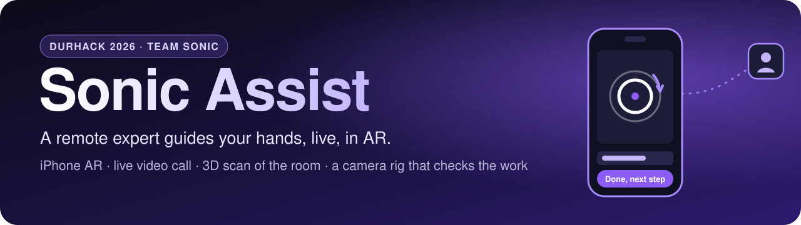
</p>

<p align="center">
  
  
  
  
  
</p>

<p align="center">
  <b>Step-by-step 3D guidance on a phone, from a remote expert, over a scan of the real hardware.</b><br>
  Point the phone at the job. The expert sees it live, marks the exact screw, and the phone shows you what to do.
</p>

<p align="center">
  <a href="#-see-it-live">See it live</a> ·
  <a href="#-quick-start">Quick start</a> ·
  <a href="#-what-it-does">What it does</a> ·
  <a href="#-how-it-works">How it works</a> ·
  <a href="#-whats-real">What's real</a> ·
  <a href="#-team">Team</a>
</p>

<p align="center">
  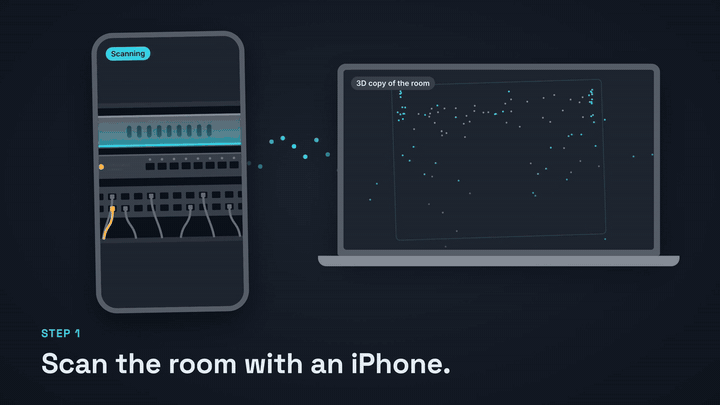<br>
  <sub>Our concept explainer from day one (<a href="docs/media/explainer.mp4">the full 28 s video</a>). Back then the project was
  called Remote Assist and the demo was a network cupboard; we built it on a laptop SSD swap instead.</sub>
</p>

---

## 🎥 See it live
Real screenshots from our own tests on 15 and 16 November.

<table>
  <tr>
    <td width="33%">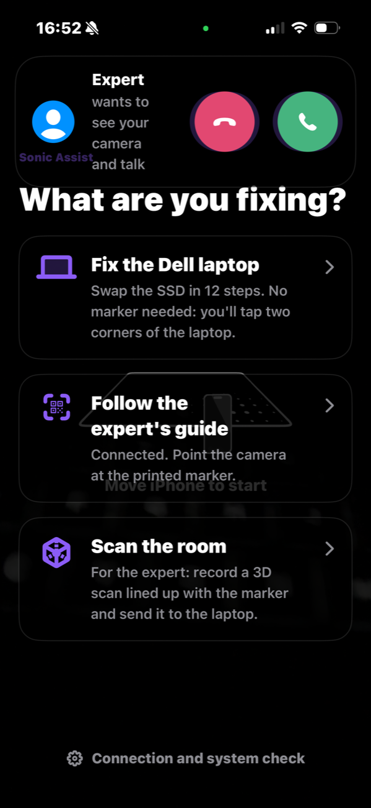</td>
    <td width="33%">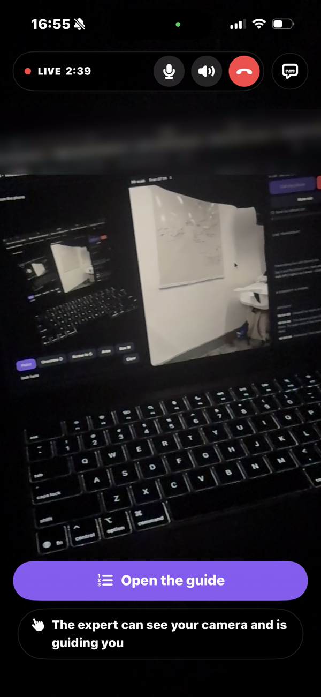</td>
    <td width="33%">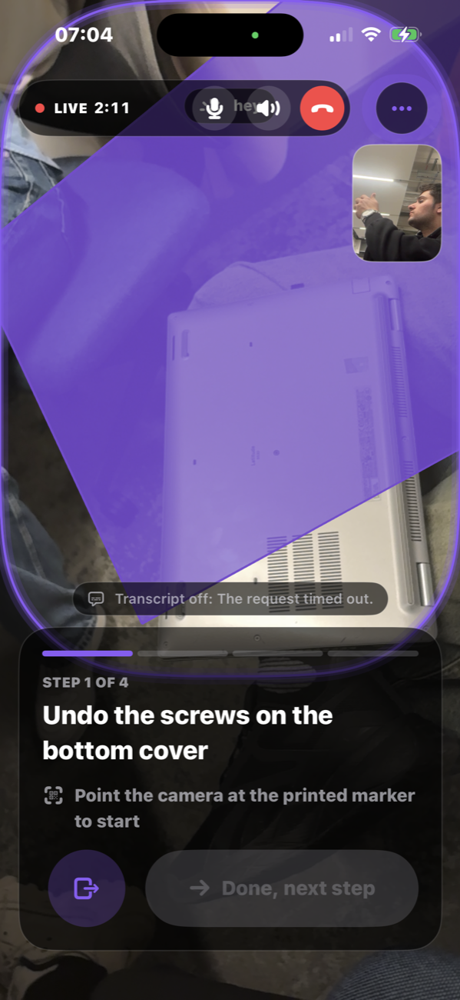</td>
  </tr>
  <tr>
    <td><sub><b>The expert calls.</b> The phone rings over the home screen (16 Nov).</sub></td>
    <td><sub><b>Live.</b> The expert sees this camera, here pointed at the console and its 3D scan (16 Nov).</sub></td>
    <td><sub><b>An Area</b> from the expert, on the laptop's bottom cover (15 Nov, an earlier style).</sub></td>
  </tr>
</table>

<p align="center">
  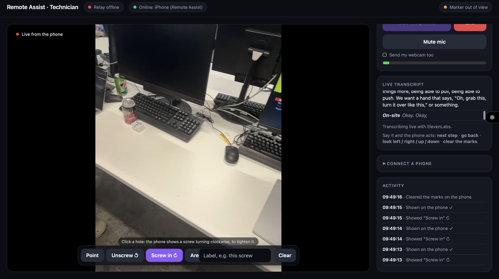<br>
  <sub><b>The expert's side of a live call</b> (15 Nov): the phone's camera, the live transcript, and each "Screw in"
  confirmed as shown on the phone.</sub>
</p>

## 💡 Why
Someone has to do a hardware fix they've never done before: here, swapping the SSD in a laptop. The person who could
do it in five minutes isn't in the room, and a video call can't point at the right screw. Sonic Assist puts the
expert's hands in the room: their marks land on the real part, through the phone's camera.

## ✨ What it does
- 📱 **The person on site points an iPhone at the hardware.** The app finds a printed marker and pins every step's 3D
  parts to it, so they stay on the laptop as the phone moves.
- 📞 **One tap calls the expert.** The technician console shows the phone's camera live, with two-way voice.
- 🎯 **The expert marks the real thing.** Click the video to place a **Point**, an **Unscrew ↺** or **Screw in ↻**
  animation, an **Area** or a 3D **Box**. It appears on the phone, on that spot. **Clear** wipes it.
- 🗣️ **Talk to drive the phone.** The call is transcribed live, and the expert can say *"next step"*, *"go back"*,
  *"look left"* or *"clear the marks"*.
- 🧊 **A 3D scan of the room sits beside the video**, so the expert can turn it and zoom in while they talk.
- 🛠️ **A guide builder.** The expert places animated steps on the scan; the phone plays them over the real laptop
  and the user taps **Done**.
- ✅ **A camera rig checks the work.** An Arduino UNO Q and a Nicla Vision watch the SSD bay and send ✓ or ✗ for
  the step to both sides.
- 📶 **It keeps going offline.** The phone holds the whole guide; its taps are sent when the network comes back.

**Technician console**

<p align="center">
  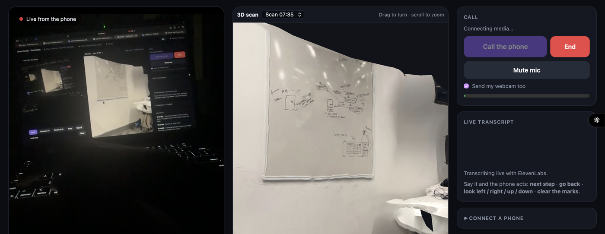<br>
  <sub>In a live call (16 Nov): the phone's camera, the 3D scan beside it, the call and the transcript.</sub>
</p>

**Expert dashboard**

<p align="center">
  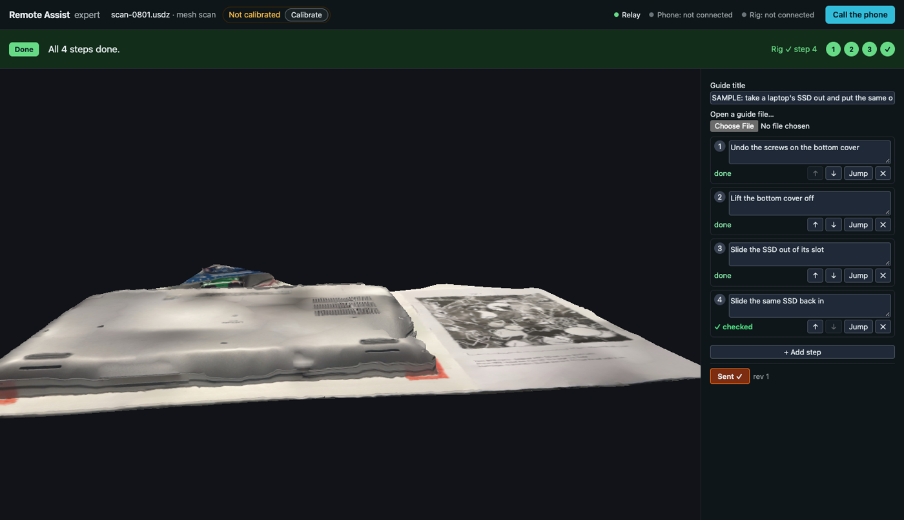<br>
  <sub>The four-step SSD guide on the scan: all done on the phone, and step 4 checked by the rig (✓).</sub>
</p>

**3D scan**

<p align="center">
  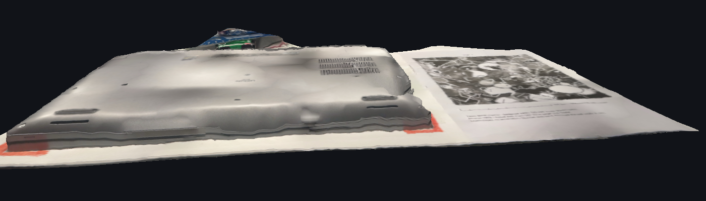<br>
  <sub>A 3D scan of the demo laptop and the printed marker beside it, made with Scaniverse on an iPhone.</sub>
</p>

## 🧭 How it works

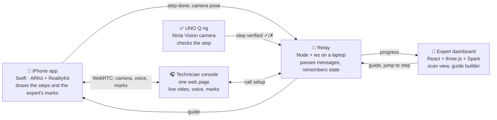

1. **Scan.** The laptop and the printed marker are scanned into 3D and loaded into the dashboard.
2. **Calibrate.** The expert clicks the marker's four corners in the scan, so every position is measured from the
   marker, in metres.
3. **Build.** The expert adds steps and places animated parts (screw, screwdriver, arrow, hand…) on the scan.
4. **Follow.** The phone finds the marker, pins each step's parts to it and plays their animations.
5. **Call.** When it's easier to show than to build, the expert calls. The video and voice go phone to laptop over
   WebRTC; the relay only sets the call up.
6. **Check.** The rig looks for a bright sticker on the SSD and reports whether the step's expected state (in the
   bay, or out of it) is what it sees.

Every part speaks one message format, written once in TypeScript: [`contracts/protocol.ts`](contracts/protocol.ts).

## ✅ The rig checks the work
<p align="center">
  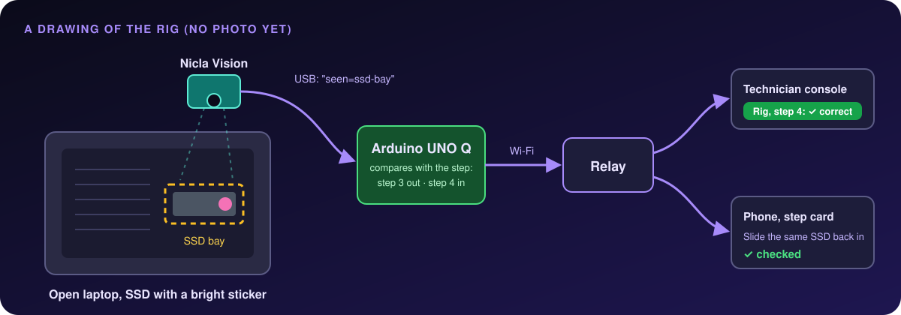
</p>

An **Arduino UNO Q** and a **Nicla Vision** camera watch the open laptop. A bright sticker on the SSD makes it easy
to spot.
- **Step 3** ("slide the SSD out") expects the bay to be empty. **Step 4** ("slide it back in") expects the SSD there.
- The Nicla says what it sees over USB. The UNO Q compares that with the current step and sends ✓ or ✗ to the relay.
- The console pops the verdict up and the phone's step card shows it. In our test, the rig's "step 4: ✓ correct"
  reached the console and the dashboard (the dashboard picture above shows "Rig ✓ step 4").

This is a drawing of the rig we built. To build your own: [`hardware/README.md`](hardware/README.md).

## 🚀 Quick start
You need a Mac with Xcode, an iPhone (iOS 18+), Node 24 and Python 3. The phone and the laptop must be on the
**same Wi-Fi** or hotspot.

**1. Get the code**
```bash
git clone https://github.com/meep-boop/durhack-2026-team-sonic.git
cd durhack-2026-team-sonic
```

**2. Start the relay** (it prints the `ws://` address the phone uses)
```bash
cd relay && npm install && npm start
```

**3. Open the technician console** at <http://localhost:8000>
```bash
cd ios/expert-call && python3 -m http.server 8000
```

**4. Start the dashboard** (the scan, the guide builder, and the console's 3D panel) at <http://localhost:5173>
```bash
cd dashboard && npm install && npm run dev
```

**5. Put the app on your iPhone**
```bash
brew install xcodegen                          # once
cd ios
./scripts/fetch-webrtc.sh                      # once: Google's WebRTC, checksum-checked
cp Secrets.xcconfig.example Secrets.xcconfig   # optional: an ElevenLabs key for the voice and the transcript
cp Local.xcconfig.example Local.xcconfig       # put your Apple Team ID in it (a free Apple ID works)
xcodegen && open RemoteAssist.xcodeproj        # pick your iPhone and press Run
```
On the phone, turn on **Developer Mode** the first time. Full steps: [`ios/README.md`](ios/README.md).

**6. Print the marker** 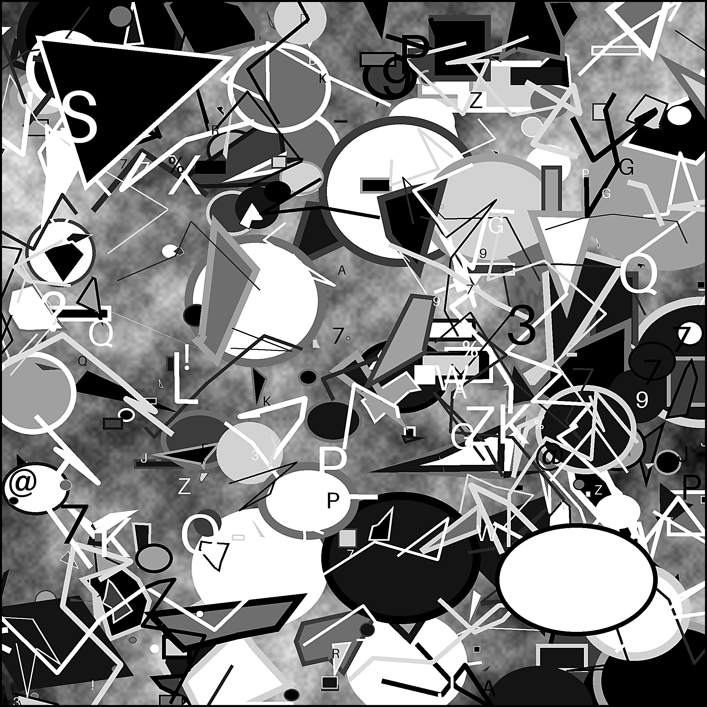

Print [`assets/marker/marker-print-A4.pdf`](assets/marker/marker-print-A4.pdf) at 100% and check it's **180 mm**
wide. Lay it flat beside the laptop.

**7. Call**

In the console, type the relay's address and press **Connect**. On the phone, tap the status capsule, then
**Scan QR**. Press **Call the phone**, then **Accept** on the phone.

**Optional: the rig.** Wiring, the Nicla script and the UNO Q app are in [`hardware/README.md`](hardware/README.md).
Point it at the same relay: `RELAY_URL=ws://<laptop-ip>:8080 python main.py`.

## 🔬 What's real
Every row was checked on our own hardware, or says plainly that it wasn't.

| Part | Status |
|---|---|
| iPhone app: marker tracking, guide steps, **Done** | **LIVE** on a real iPhone. The phone's logs show Done for all four steps reaching the relay |
| Live call: the phone's camera and two-way voice | **LIVE**, peer to peer over WebRTC on one Wi-Fi |
| Expert marks: Point, Unscrew, Screw in, Area, Box, Clear | **LIVE** on the phone. Areas and boxes need a surface the phone has found |
| Live camera stays smooth | **Measured** in the phone's own logs: 60 fps on screen and 0 dropped drawables over our test sessions |
| Live transcript and spoken commands (ElevenLabs Scribe) | **Worked live** in our calls. It needs an ElevenLabs key with credit; ours ran out at the end |
| Step voice | ElevenLabs when the key has credit, otherwise the built-in iOS voice |
| Relay: routing, replay on reconnect, saved state | **LIVE**, 42 tests |
| Expert dashboard: scan view, calibration, guide builder | **LIVE**, 54 tests |
| 3D scans of the demo laptop | **Real**: three Scaniverse scans in [`dashboard/public/scans/`](dashboard/public/scans) |
| Room scan from the app, to the laptop | Photos and camera positions reach the laptop's scan inbox. Training a splat from them on the DGX Spark is written, not shown |
| Rig (UNO Q + Nicla Vision) | Ran on the hardware: its ✓ for step 4 reached the relay and the dashboard |
| Fake phone and fake expert ([`fixtures/`](fixtures)) | Test tools only. Their camera poses are **SIMULATED** and never shown as real |
| Alignment accuracy in millimetres | **Not measured** |

## 🧪 Tests
```bash
cd relay && npm test && npm run typecheck                        # 42 tests
cd dashboard && npm test && npm run typecheck                    # 54 tests
node --test pipeline/scan-inbox.test.ts                          # 6 tests
cd hardware/unoq/python && python -m unittest test_rig           # 14 tests
python -m unittest discover assets/models                        # 7 tests
cd ios && xcodebuild test -scheme RemoteAssist \
  -destination 'platform=iOS Simulator,name=iPhone 16'           # 81 tests
```

## 🧱 Tech stack
| Layer | Choice | Why over the obvious alternative |
|---|---|---|
| Phone | Native Swift, ARKit + RealityKit | iPhone Safari has no WebXR AR, so a web app couldn't draw over the camera |
| Lining up | A printed marker, tracked as an ARKit image | No LiDAR on our phones, and tapping points by hand is unreliable on small parts |
| Live call | WebRTC (Google's framework on iOS, the browser's in the console) | Video and voice go straight between the two devices; the relay only passes the setup messages |
| Live transcript | ElevenLabs Scribe, realtime | The console transcribes both voices; the phone hands it single-use tokens, so the key never leaves the phone |
| Dashboard | Vite + React + TypeScript, three.js + Spark | Spark renders splats inside plain three.js |
| Relay | Node + `ws`, plain `ws://` on the local network | No build step, and iPhones don't trust self-made certificates |
| Rig | Arduino UNO Q + Nicla Vision, colour blobs | The hardware challenge's kit; a bright sticker is simple to find on camera |
| Models | Generated by one Python script into glTF and USDZ | The two formats can't drift apart; each file is under 7 KB |

## 🗂️ Repo layout
| Folder | What's in it |
|---|---|
| [`ios/`](ios) | The iPhone app, and [`ios/expert-call/`](ios/expert-call): the technician console |
| [`dashboard/`](dashboard) | The expert's web app: 3D view (`src/scene/`), guide builder (`src/guide/`), the scans |
| [`relay/`](relay) | The relay server and its tests |
| [`contracts/`](contracts) | The message format every part speaks |
| [`hardware/`](hardware) | The UNO Q rig and the Nicla Vision code |
| [`pipeline/`](pipeline) | The laptop's scan inbox and the splat trainer |
| [`assets/`](assets) | The printed marker and the 3D models |
| [`fixtures/`](fixtures) | Sample guides, example messages, a fake phone and a fake expert for testing |
| [`docs/`](docs) | Plain-language notes ([`docs/vault/`](docs/vault)), the plan, and [the team kit](docs/team-kit.md) |

## 🩹 What went wrong, and what we changed
- **The demo set changed from a network cupboard to a laptop.** The same kind of job (screws, a cover, a part out
  and back in) on hardware we had on the table. The rig's question moved from "which port is the cable in?" to "is
  the SSD in its bay?".
- **The phone app went native.** We started in Expo (React Native), but iPhone AR needs ARKit directly, so we
  rebuilt it in Swift with ARKit and RealityKit.
- **The live camera froze and went black.** The AR view sometimes stopped drawing. The phone now watches its own
  frame rate and slides the raw camera feed underneath, so the picture never stops.
- **The guide landed across the room.** The phone scaled the whole guide by ARKit's guess of the marker's size. Now
  only the outline is scaled, the expert's marks are pinned to the marker, and the guide can be locked onto the real
  laptop with two taps.
- **No supercomputer.** The plan assumed Dawn access for training splats; we didn't get it, so the route is the
  team's own DGX Spark.

## 🔭 Limits and next steps
- The live call needs both devices on one network (no TURN server yet).

## 👋 Team
| Who | Built |
|---|---|
| Ahmed (`meep-boop`) | Relay, message format, sync, UNO Q rig, team kit |
| Max (`xaw1`) | Dashboard 3D view, splats, scan pipeline, the original plan |
| Laura (`furtunalaura`) | Guide builder, marker, 3D models, demo set, the README draft and the video |
| Salman (`salman-abdulrazaq-ali`) | The iPhone app and the technician console (live call, marks, transcript) |

## 📦 Open source and data
Versions are the ones installed from each part's package files.

| Part | Libraries | Licence |
|---|---|---|
| Dashboard | React 19.3, Vite 8.3, three.js 0.187, Spark 2.4 (`@sparkjsdev/spark`), TypeScript 7.0 | MIT (TypeScript: Apache-2.0) |
| Relay | Node 24, `ws` 8.23, TypeScript 7.0 | MIT (`ws`), Apache-2.0 (TypeScript) |
| iPhone app | Swift, ARKit, RealityKit (Apple); Google's WebRTC M156 via `stasel/WebRTC` | WebRTC: BSD-3-Clause |
| Rig | OpenMV firmware on the Nicla Vision; `pyserial` 3.5, `websocket-client` 1.9.2 on the UNO Q | BSD (`pyserial`), Apache-2.0 (`websocket-client`) |
| 3D models | Pixar's USD (`usd-core` 26.11), only to build the model files | Tomorrow Open Source Technology License 1.0 |
| Marker image and 3D models | Made by us during the event | Ours |
| Scans of the demo laptop | Made by us with Scaniverse | Ours |

<p align="center"><sub>Made in 24 hours at DurHack 2026 by Team Sonic.</sub></p>
