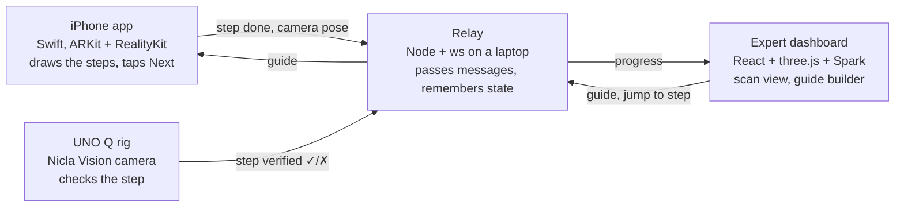

> **This draft is now the repo's [`README.md`](../README.md)**, filled in and updated on 2026-11-16. Edit that file, not this one.

<!--
DRAFT of the judges' README (Laura's task 6). Before submitting, this replaces the root README.md (pitch skill).
Rules while it's a draft:
- Every claim matches the demo video and PROJECT.md. Nothing from PROJECT.md → NOW → "Never pitch".
- "What's real" is updated the moment a part changes state. Today most parts are IN PROGRESS: say so.
- TODO marks a gap to fill. Don't fill one with a guess.
-->

# Sonic Assist
> Step-by-step 3D guidance on a phone, built by a remote expert from a scan of the room, that keeps working when the
> network drops. Built by Team Sonic at DurHack 2026.

**[Demo video](TODO) · [Slides](TODO)**

_TODO: one screenshot of the money shot: the phone showing an orange arrow and screwdriver over the real laptop's
SSD cover, with the step text below._

## Why
_TODO: the person, the harm, one sourced number (two or three sentences). The number has to be in
`research/ledger.md` first, rated KEEP. Shape: someone has to do a hardware fix they've never done (here, swapping a
laptop's SSD), the expert who could do it in five minutes isn't in the room, and a video call can't point at the
right screw._

## What it does
- The person on site points an iPhone at the hardware; a remote expert sees a 3D scan of it on their laptop.
- The expert builds a guide: steps of animated 3D objects (screw, screwdriver, arrow, hand…) placed on the exact
  parts, each with one instruction.
- The phone draws each step over the real hardware, lined up by a printed marker, and the user taps **Next**.
- A camera rig checks the step really happened (is the SSD in its bay?) and shows ✓ or ✗ to both sides.
- The phone keeps the whole guide, so the user can keep going if the network drops; their taps are sent when it's
  back.

## How it works



1. **Scan.** The hardware and the printed marker are scanned into a 3D splat and loaded into the dashboard.
2. **Calibrate.** The expert clicks the marker's four corners in the scan, so every position can be measured from
   the marker, in metres.
3. **Build.** The expert adds steps and places models on the scan. The guide builder keeps the only copy of the
   guide and sends the whole guide on every edit.
4. **Follow.** The phone finds the printed marker, pins each step's models to it, and plays their animations.
5. **Check.** The rig's camera looks for a bright sticker on the SSD and reports whether the step's expected state
   (in the bay, or gone from it) is what it sees.

The message format every part speaks is one TypeScript file: `contracts/protocol.ts`.

## What's real
_Update before submitting: every row ends as LIVE, SIMULATED, MOCK or REPLAY, and the video shows the same._

| Part | Status (2026-11-14 night) |
|---|---|
| Relay: routing, replay on reconnect, saved state | Built and tested (32 tests), not yet run with the real phone |
| Fake phone and fake expert (`fixtures/`) | Test tools only: their camera poses are SIMULATED and never in the demo |
| Printed marker | Real: printed, measured 180 × 180 mm |
| 3D models (7 tests) | Real files, not yet loaded in either app |
| Guide builder: editing and progress logic (19 tests) | Built; the panel on screen is not built yet |
| Dashboard 3D view | In progress: shows Spark's SAMPLE splat, not our scan yet |
| iPhone app | In progress |
| Rig (UNO Q + Nicla Vision) | Code written and tested without hardware; not yet run on the Nicla |
| Scan of the demo laptop | Not made yet |
| AI labels on the scan (Claude) | Relay endpoint built; made by AI, shown as such, and the expert can fix or delete each one |

## Tech stack
| Layer | Choice | Why over the obvious alternative |
|---|---|---|
| Phone | Native Swift, ARKit + RealityKit | iPhone Safari has no WebXR AR, so a web app couldn't draw over the camera |
| Lining up | A printed marker, tracked as an ARKit image anchor | No LiDAR on our phones; tapping points by hand is unreliable on small parts (`research/ledger.md` § 3) |
| Dashboard | Vite + React + TypeScript, three.js + Spark | Spark renders splats inside plain three.js; chosen after a spike with a kill test (§ 7) |
| Relay | Node + `ws`, plain `ws://` on a phone hotspot | No build step; venue Wi-Fi is slow, and iPhones don't trust self-made certificates |
| Live video | WebRTC, signalled over the relay | TODO: one line on why, from the Decision log |
| Rig | Arduino UNO Q + Nicla Vision, colour blobs | The RS challenge's hardware. TODO: why colour blobs, from Ahmed's research (`research/ledger.md` § 10) |
| Models | Generated by one Python script into glTF and USDZ | The two formats can't drift apart; each file is under 7 KB |

## Results
_TODO: only measured numbers, each with how it was measured. Candidates: alignment error on the real set (mm, with
a ruler), time for a first-timer to swap the SSD with the guide. None measured yet._

## Run it
```bash
# Relay (prints the ws:// address for the phone and dashboard)
cd relay && npm install && npm start

# Dashboard (TODO: confirm once Max's dashboard is on main)
cd dashboard && npm install && npm run dev

# Rebuild the 3D models (optional; the built files are committed)
python -m venv .venv && .venv/Scripts/pip install -r assets/models/requirements.txt
.venv/Scripts/python assets/models/build_models.py

# Tests
cd relay && npm test && npm run typecheck
node --test "dashboard/src/guide/*.test.ts"
python -m unittest discover assets/models
```
_TODO: the iPhone app (Xcode steps) and the rig (`hardware/README.md`)._

## Repo layout
| Folder | What's in it |
|---|---|
| `contracts/` | The message format every part speaks |
| `relay/` | The relay server and its tests |
| `dashboard/` | The expert's web app: 3D view (`src/scene/`) and guide builder (`src/guide/`) |
| `ios/` | The iPhone app |
| `hardware/` | The UNO Q rig and Nicla Vision code |
| `assets/` | The printed marker and the 3D models |
| `fixtures/` | A sample guide, example messages, a fake phone and a fake expert for testing |
| `docs/remote-assist/` | The plan and design notes |

## Data and licences
| What | Source | Licence / note |
|---|---|---|
| Marker image | Generated by us during the event | Ours |
| 3D models | Generated by `assets/models/build_models.py` during the event | Ours, no third-party models |
| Sample splat in the dashboard | Spark's demo file | SAMPLE, never shown as our scan. TODO: licence |
| Scan of the demo laptop | Made by us | TODO: with which app |

## What went wrong, and what we changed
- **The demo set changed from a network cupboard to a laptop.** We planned a router, patch panel and cable, then
  switched to swapping the SSD in a team member's laptop: the same kind of job (screws, a cover, a part out and
  back in). _TODO: the team's real reason in one line._ The camera check moved from "which port is the cable in?" to
  "is the SSD in its bay?".
- **The phone app went native.** We started in Expo (React Native) but iPhone AR needs ARKit directly, so we
  dropped it for Swift with ARKit and RealityKit.
- **No supercomputer.** The plan assumed Dawn access for training splats; we didn't get it, so the upgrade route is
  the team's own DGX Spark.
- _TODO: one more from the build itself, e.g. what broke the first time the phone and dashboard talked._

## Limits and next steps
- A scan is a snapshot: if the hardware moves after scanning, the guide's positions are off.
- The marker has to stay fixed to the hardware, and accuracy drops further from it.
- The rig can mistake a hand covering the sticker for the part being gone.
- _TODO: what we'd build next._

## Team
| Who | Did |
|---|---|
| Ahmed (`meep-boop`) | Relay, message format, sync, UNO Q rig, AI labelling, team kit |
| Max (`xaw1`) | Dashboard 3D view, splats, scan pipeline, the original plan |
| Laura (`furtunalaura`) | Guide builder, marker, 3D models, demo set, README and video |
| Salman (`salman-abdulrazaq-ali`) | The iPhone app |

## Open source and acknowledgements
DurHack asks every framework to be listed here. Versions are the ones pinned in each part's package file.

| Part | Libraries | Licence |
|---|---|---|
| Dashboard | React 19.3, Vite 8.3, three.js 0.187, Spark 2.4 (`@sparkjsdev/spark`), TypeScript 7 | TODO: check each |
| Relay | Node 24, `ws` 8.23, Anthropic SDK 1.8 (`@anthropic-ai/sdk`), TypeScript 7 | TODO |
| iPhone app | Swift, ARKit, RealityKit (Apple); Google's WebRTC framework via `stasel/WebRTC` | TODO |
| Rig | OpenMV firmware on the Nicla Vision; `pyserial` 3.5, `websocket-client` 1.9.2 on the UNO Q | TODO |
| 3D models | Pixar's USD (`usd-core` 26.11), only to build the model files | Modified Apache 2.0 (TODO: confirm) |

_TODO: the final check of every package file and Swift package just before submitting, since parts are still landing._

## AI use
DurHack asks for AI tools to be credited explicitly. We used:
- **Claude Code (Anthropic)**, throughout the build, to write and test code and docs. Every design decision was made
  by a team member, and our decision log records who decided what.
- **Claude (Anthropic API)**, inside the product: it suggests labels for parts in a snapshot of the scan, so the
  expert can find a part by name. Labels are marked as made by AI, never reach the phone, and the expert can fix or
  delete each one.
- **ElevenLabs**, inside the iPhone app as an optional spoken voice. _TODO: keep this line only if ElevenLabs is in the
  demo build (ask Salman); otherwise delete it._
