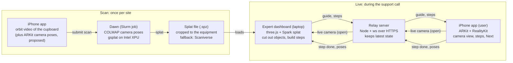

# Architecture

Updated 2026-11-14 after grilling round 1: the on-site device is now an **iPhone app** (no Quest), and guidance is
**stepped 3D animations** on top of highlight boxes. Anything marked **proposed** or **open** isn't decided.

The heavy work (turning the scan into a splat) happens once, before the guide is built. While the guide plays, only
small JSON messages and the live camera stream move. The phone never renders the splat; it only draws the guide's
objects over its own camera view.



## Components

| Piece | Runs on | Stack |
|---|---|---|
| Phone app | iPhone (user) | Native Swift app, ARKit + RealityKit. Live camera share, scan capture and upload, step player with **Next**. Needs a Mac with Xcode to build (open task) |
| Splat pipeline | Dawn (Slurm batch) | ffmpeg frames → COLMAP or GLOMAP camera poses → gsplat (Intel XPU fork, `isl-org/gsplat`) → crop and compress to .spz/.ksplat |
| Splat fallback | iPhone | Scaniverse app (free, on-device splats) → export .ply |
| Relay server | Team laptop | Node + `ws`, over HTTPS. Keeps the latest guide and replays it to anyone who reconnects |
| Expert dashboard | Laptop browser | three.js + Spark splat renderer: live view, cut objects out of the splat, place built-in models, build the step timeline |
| Live video | Phone → dashboard | **Open.** WebRTC is the usual choice. A new dependency, so it's a 🟠 decision |

Library choices above are the planning-session recommendation. Each new dependency is still the builder's call
(CLAUDE.md §2).

## The guide: steps of animated 3D objects

A **guide** is an ordered list of steps. Each step has a short instruction and one or more objects. Each object is:

- **what it is:** a built-in model (screw, bolt, arrow, screwdriver, hand) or a **cut-out** from the scan;
- **where it is:** position, rotation and size in splat coordinates;
- **what it does:** one preset action (`unscrew`, `pull`, `push`, `flip`, `rotate90`), plus its axis;
- **a highlight box** around the real part, always shown. The box says *where*, the animation says *how*.

The user taps **Next** to move on. Each step's animation loops until then.

**Built-in models (decided: A).** A small set we make or find. The phone (RealityKit) wants USDZ and the dashboard
(three.js) wants glTF, so each model probably needs both formats. **Open:** convert once by hand, or pick one format
and convert at load.

**Cut-outs from the scan (decided: D).** Splats are a cloud of blurry points with no mesh and no edges between parts.
- **Proposed, simplest:** the expert draws a box around the part in the dashboard. The splat points inside become
  their own object, which can be moved, highlighted and animated. Good enough on the laptop.
- **The phone is harder:** RealityKit doesn't draw splats. Options to decide in a later round: send the phone a
  matching built-in model instead of the cut-out, turn the cut-out into a rough mesh, or show only the box and arrow
  on the phone.

**Clicking on a splat:** there's no mesh to hit. On click, take the splat centre nearest the mouse ray (within about
1 cm) that's closest to the camera. A brute-force pass over about 300k centres is fast enough for a click.

## Lining up the scan with the real room (open)

Everything in the guide lives in the splat's frame. The phone has to know where that frame sits in its own ARKit
world. The Quest plan used four coloured stickers touched with a controller; that's parked. Options for the iPhone,
for the next grilling round:

- **Stickers, tapped on screen:** the user taps each of the four stickers in the camera view and ARKit finds the 3D
  point under each tap. Then solve the same similarity transform as before (rotation, translation and **scale**,
  Umeyama method), and show the leftover error in cm.
- **A printed marker:** one image stuck to the equipment that ARKit tracks as an image anchor. One step, no tapping.
- **Same phone, same session:** if the scan is taken with ARKit running, its camera poses are already in the phone's
  frame. Only works if the session isn't restarted between scan and guide.

```
p_phone = s · R · p_splat + t
```

## Message protocol (draft, needs agreeing)

Put it in a shared contract file (e.g. `contracts/protocol.ts`) so the phone and dashboard sides can build against
a fake peer. All positions are in splat coordinates.

```json
{"type":"hello", "role":"expert" | "user"}
{"type":"calib.points", "points":[[x,y,z],[x,y,z],[x,y,z],[x,y,z]]}
{"type":"guide.set", "guide":{"id":"g1", "steps":[
  {"index":1, "text":"Remove the top-left screw",
   "objects":[{"id":"o1", "model":"screw", "pos":[x,y,z], "rot":[x,y,z,w], "size":[w,h,d],
               "action":"unscrew", "axis":[x,y,z]}]}
]}}
{"type":"step.set", "index":1}
{"type":"step.done", "index":1}
{"type":"pose", "t":1731600000, "camera":{"p":[..],"q":[..]}}
```

- The relay keeps the latest guide and the current step, and replays them to anyone who reconnects.
- **Next** on the phone sends `step.done`. The expert can also jump with `step.set`.
- `pose` streams the phone camera's position so the dashboard can show where the user is standing inside the scan.
- **Proposed (Neptune North):** the phone keeps the whole guide locally and keeps playing when the relay is
  unreachable. It queues `step.done` and sends it on reconnect. Not decided: what the expert sees while the link is
  down, and what happens if the expert edited the guide in the meantime.
- **Not yet in the protocol:** live camera (separate, via WebRTC if chosen), uploading the scan, and streaming
  cut-outs or models to the phone.

## Device limits we planned around

- **iPhone apps need a Mac.** No Mac with Xcode means no native app. Check this first.
- iPhone Safari has no WebXR AR, which is why it's a native app and not a web page.
- The Quest 2 limits from the first plan (no scanning, no camera access, greyscale passthrough) no longer apply. The
  Quest is parked (see README).
