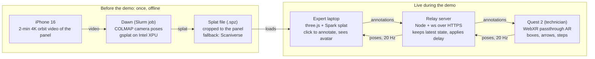

# Architecture

The heavy work (the splat) happens once before the demo. During the demo only small JSON messages move, and the Quest
never renders the splat itself. Everything is a web page or a script: no app store, Xcode or Unity build.



## Components

| Piece | Runs on | Stack |
|---|---|---|
| Capture | iPhone 16 camera | Plain 4K video, a slow 2-minute orbit of the panel. No custom app |
| Splat pipeline | Dawn (Slurm batch) | ffmpeg frames → COLMAP or GLOMAP camera poses → gsplat (Intel XPU fork, `isl-org/gsplat`) → crop and compress to .spz/.ksplat |
| Splat fallback | iPhone | Scaniverse app (free, on-device splats, no LiDAR) → export .ply |
| Relay server | Team laptop | Node + `ws`, served over HTTPS (Vite basic-ssl plugin). Applies the delay |
| Expert app | Laptop browser | three.js + Spark splat renderer: click to annotate, step list, avatar, delay toggle |
| Technician app | Quest 2 browser | three.js WebXR `immersive-ar` (greyscale passthrough): calibration, highlights, off-view arrow, pose streaming |

Library choices above are the planning-session recommendation. Each new dependency is still the builder's call
(CLAUDE.md §2).

**Clicking on a splat:** splats have no mesh to raycast against. On click, take the splat centre nearest the mouse ray
(within about 1 cm) that is closest to the camera. A brute-force pass over about 300k centres is fast enough for a
click.

**Device limits we planned around:**
- The Quest 2 can't scan, and apps can't read its camera feed (only Quest 3/3S allow that). So no AI outline on the
  headset; the target is a bright 3D box instead.
- iPhone Safari has no WebXR AR, so the iPhone is only the scan camera (and, if proposed, a second technician via a
  native or ARKit app, which needs a Mac).
- The Quest 2 passthrough is grainy and greyscale: highlights must be thick, bright and pulsing.

## Coordinate frames and calibration

All annotations live in the splat's frame. The Quest converts them into its own frame using four coloured stickers.

1. Stick four coloured dots on the panel's corners before scanning, so they appear in the splat.
2. The expert clicks each dot once in the splat: four points in splat coordinates.
3. The technician touches each dot with the controller tip and pulls the trigger: the same four points in the Quest's
   `local-floor` frame.
4. The Quest solves a similarity transform (rotation, translation and **scale**) with the Umeyama method. Scale is
   needed because COLMAP's units are arbitrary; a Scaniverse splat is already roughly in metres.
5. Show the leftover error in cm. Above about 2 cm, redo the calibration.

```
p_quest = s · R · p_splat + t
```

- Annotations go splat → Quest with that transform. Head and controller poses go Quest → splat with its inverse, so
  the avatar appears in the right place.
- Tune the controller-tip offset from the grip pose once: draw a small sphere at the tip and adjust until it touches
  the table exactly.
- Add a "Recalibrate" button. The Quest's origin can jump if tracking resets or the guardian is redrawn.

## Message protocol

Agree this first and put it in a shared contract file (e.g. `contracts/protocol.ts`), so the expert and headset
sides can build against a fake peer. All positions are in splat coordinates.

```json
{"type":"hello", "role":"expert" | "tech"}
{"type":"calib.points", "points":[[x,y,z],[x,y,z],[x,y,z],[x,y,z]]}
{"type":"annotation.upsert", "id":"a1", "step":1, "label":"Breaker 14", "pos":[x,y,z], "size":[w,h,d]}
{"type":"annotation.remove", "id":"a1"}
{"type":"step.set", "index":1}
{"type":"step.done", "index":1}
{"type":"pose", "t":1731600000, "head":{"p":[..],"q":[..]}, "left":{"p":[..],"q":[..]}, "right":{"p":[..],"q":[..]}}
{"type":"delay.set", "seconds":20}
```

- `pose` goes tech → expert at about 20 Hz. Everything else goes expert → tech, except `step.done`.
- The relay keeps the latest state (calibration points, annotations, current step) and replays it to anyone who
  reconnects. The Quest browser reloads a lot during development.
- The delay applies in the relay, both directions, one queue per direction. Annotations marked before the delay is on
  are already on the Quest, which is the point of the Mars demo.
- **Proposed (Neptune North):** a blackout mode where the Quest keeps the whole procedure locally, keeps guiding when
  the relay is unreachable, and sends its queued `step.done` and poses when it reconnects. Not decided.
