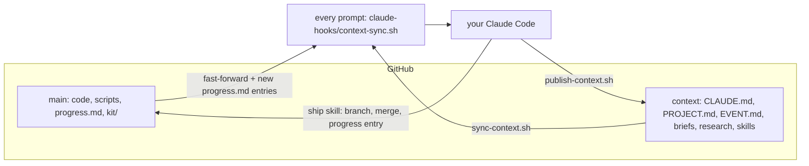

# Team Sonic · DurHack 2026: the team kit

> This was the repo's README during the event. The project's README is now [`README.md`](../README.md).

Our repo for DurHack 2026. Right now it holds **the team kit**: how we run Claude Code as a team, so that
everyone's agents build one product instead of one each. The project code lands here once we pick the idea. Before we
submit, this README is replaced by the judges' version (`kit/README.judges.template.md`, via the `pitch` skill).

## Start here (each teammate, ~5 minutes)
In **Git Bash** on Windows (plain `bash` in PowerShell can start WSL instead) or any terminal on Mac/Linux:
```bash
git clone https://github.com/meep-boop/durhack-2026-team-sonic.git && cd durhack-2026-team-sonic
git config user.email "<the email on YOUR GitHub account>"   # judges read who committed
bash scripts/setup.sh <your key>                             # keys are in team.conf; ask Ahmed to add yours
```
Then open **Claude Code in this folder** (trust it when asked, so the hook runs) and say **"fetch the context"**.

Optional but recommended: [gitleaks](https://github.com/gitleaks/gitleaks) (`winget install Gitleaks.Gitleaks` or
`brew install gitleaks`), so every commit is scanned for secrets.

## How it works



- **Two branches, two jobs.** `main` is what judges see: code, `progress.md` (the build log and conflict board) and
  this kit. The **`context`** branch holds the shared docs every agent works from. It never merges into `main`, and
  it's deleted before the repo goes public.
- **Every prompt starts in sync.** `.claude/settings.json` runs a hook before Claude reads your prompt. It
  fast-forwards your code, pulls any doc changes, and shows new `progress.md` entries, including any conflict someone
  flagged for you.
- **The charter (`CLAUDE.md`) keeps you in charge.** Claude stops at every design decision and hands it to you with
  options and a recommendation. It never silently picks a database, an API shape or a dependency.
- **One feature at a time.** no-slop → tests → your branch → merge `main` in and re-test → merge to `main` → a
  `progress.md` entry that names anyone whose code you touched.

## What's where
| On `main` | On `context` (unpacked into your folder, git-ignored on `main`) |
|---|---|
| `scripts/`: setup, sync, publish, init, checks, tests, git and Claude hooks | `CLAUDE.md`: the working rules |
| `team.conf`: builder keys, docs owners, branch name | `PROJECT.md`: NOW (headline, clock, decisions, tasks), spec, design, decision log |
| `progress.md`: build log + conflict board | `EVENT.md`: rules, judging, submission checklist |
| `kit/`: the templates the `context` branch is built from | `builder-file-<name>.md`: each person's brief |
| `.claude/settings.json`: registers the every-prompt hook | `research/ledger.md`: every source rated KEEP / WEAK / DO NOT USE |
| | `.claude/skills/`: the skills below |

## Skills
| Skill | When it runs |
|---|---|
| `fetch-context` | Start of a session: who you are, what changed, your next task, conflicts for you |
| `ship` | A feature is done: no-slop, tests, branch, merge, progress entry |
| `team-docs` | Assigning work, logging a decision, editing a brief or NOW |
| `research-ledger` | Any research: sources rated and saved in the same pass |
| `idea-forge` | Picking the idea: harsh judges, red teams, a feasibility check, the anti-wrapper test |
| `pitch` | Demo video, deck, judges' README, submission |
| `sign-off` | Leaving: save, de-stale, START HERE pointer |
| `no-slop` | After every code change: cuts AI bloat, checks Big-O |
| `debug` | Any error, failing test, or being stuck |
| `design-direction` · `motion` · `motion-review` · `ui-audit` · `reverse-engineer-ui` · `frontend-performance` | Front-end work |

## Scripts
| Command | Who, when |
|---|---|
| `bash scripts/setup.sh <key>` | Everyone, once per clone |
| `bash scripts/init-context.sh` | A docs owner, once per project (already done for this repo) |
| `bash scripts/sync-context.sh` | Automatic via the hook; by hand if the hook didn't run |
| `bash scripts/publish-context.sh "what changed"` | After any shared-doc edit (owners: anything; others: research + their own brief) |
| `bash scripts/submission-check.sh` | Before submitting or going public |
| `bash scripts/test-context-scripts.sh` · `bash scripts/test-git-hooks.sh` | After changing the scripts |

## Claude Code plugins we use (optional)
The kit works on plain Claude Code. These are what Ahmed runs, installed with `/plugin` inside Claude Code:
- `superpowers@claude-plugins-official`: brainstorming, TDD, systematic debugging, plans
- `context7@claude-plugins-official`: current library docs (the research rule says check docs, not memory)
- `oh-my-claudecode@omc` (marketplace: `Yeachan-Heo/oh-my-claudecode`): multi-agent orchestration
- `firecrawl@anthropic-plugin-directory`, `exa-deep-research@anthropic-plugin-directory`: web research
- `ralph-loop@claude-plugins-official`: long-running loops

## What's new since the datathon
The flow is the one we used for Blacknaught at the IBM Z Datathon, generalised and with its rough edges fixed:
- **Nothing is hard-coded to one team.** Names, docs owners and the branch name come from `team.conf`.
  `init-context.sh` builds the `context` branch from `kit/` for any project.
- **The hook is on `main`** (`.claude/settings.json`), so it works on clone with no manual setup.
- **A leaner charter.** The step-by-step protocols moved into on-demand skills (`ship`, `team-docs`, `sign-off`,
  `research-ledger`), so `CLAUDE.md`, loaded on every prompt, is about 40% shorter (2,949 words, down from 4,747).
- **New skills** from what won us time: `idea-forge` (how we picked the idea) and `pitch` (the video skeleton, the
  honesty pass, the submission run).
- **Fixes for the datathon's clobber bug and leaked-credential scare are kept and tested:** a stale copy can't undo a
  teammate's edit, and the secret guard matches credential shapes (plus gitleaks when installed), never fragments of
  real ones.
- **Teammates can publish research**, and status updates to their own brief, without waiting on a docs owner.
- **One home per volatile fact:** deadlines in `PROJECT.md` → Clock, status in `progress.md` → Latest. The
  datathon's briefs carried stale freeze times.
- **`submission-check.sh`:** shared docs leaked onto `main`, secrets in history, unmerged branches, the context branch
  still up, and commits per member.

## Reuse it for another project
Copy `kit/`, `scripts/`, `team.conf`, `.gitignore`, `.gitattributes` and `.claude/settings.json` into a new repo.
Edit `team.conf`, push `main`, then run `bash scripts/setup.sh <key>` and `bash scripts/init-context.sh`.
