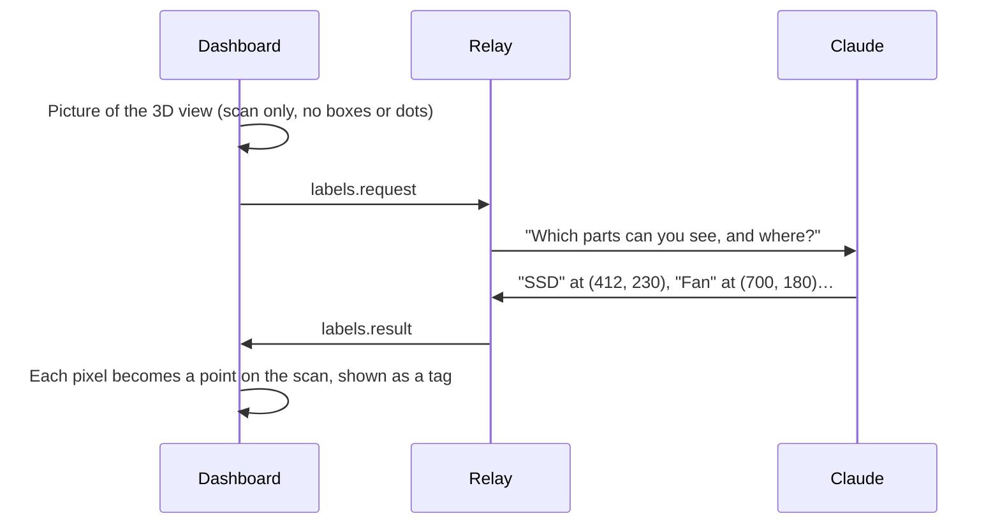

# AI labels: "find a part by name"

Back to [Home](README.md) · Dashboard side: **Max** ([`Labels.tsx`](https://github.com/meep-boop/durhack-2026-team-sonic/blob/main/dashboard/src/scene/Labels.tsx)) · Relay side: **Ahmed** ([`relay/labeller.ts`](https://github.com/meep-boop/durhack-2026-team-sonic/blob/main/relay/labeller.ts))

## What it does

The expert can type "SSD" and the [dashboard](dashboard.md)'s 3D view flies straight to it. The names come from
Claude, Anthropic's AI model, which reads a picture of the scan. This is our entry for the Accenture challenge.



1. Press **Label this view (AI, paid)** in the bottom-left panel.
2. The dashboard takes a picture of the [scan](scans.md) as you see it, without the yellow boxes or dots, so Claude
   doesn't mistake them for parts.
3. The [relay](relay.md) asks Claude. It goes through the relay so the API key only lives on that one laptop, never
   in the browser.
4. Claude answers with names at points in the picture. The dashboard turns each point into a spot on the scan, using
   the view the picture was taken from, so moving the camera while you wait doesn't shift them. A name that lands on
   empty space is dropped.
5. Tags appear on the scan. Type in the search box to highlight the best match and fly to it.

## Honest by design

- Every label is marked **AI**, with the name of the model that made it.
- Claude is told to leave out anything it would have to guess: no label is better than a wrong one.
- The expert can rename or delete any label.

## Turning it on

It's **off unless the relay starts with `--labels`**, because every picture is a billed call to Anthropic's API.

```bash
cd relay && npm start -- --labels
```

The laptop running the relay needs an Anthropic API key in its environment (`ANTHROPIC_API_KEY`). Never put the
key in the repo, a doc or a screenshot. Without `--labels`, the button shows the relay's refusal.

## Limits

- Labels stay in the open page: a reload means asking again.
- They never go to the phone and aren't part of the guide. They help the expert find a part; **Place on scan** then
  puts the guide's object there.
