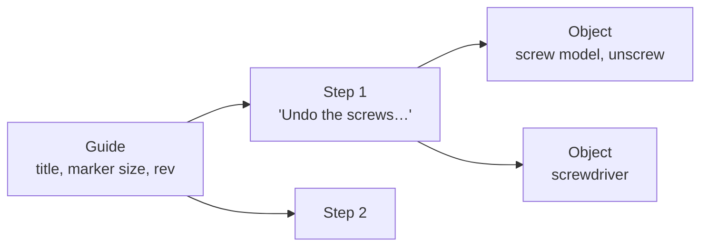

# Guides

Back to [Home](README.md) · Built in the [dashboard](dashboard.md)'s guide panel (Laura) · Shape: [`contracts/protocol.ts`](https://github.com/meep-boop/durhack-2026-team-sonic/blob/main/contracts/protocol.ts)

A guide is what the expert builds and the person on site follows: a list of **steps**, each with an instruction and
the **objects** that show where and how.

## An object

| Part | Meaning |
|---|---|
| **model** | the little 3D model the phone animates: `screw`, `bolt`, `arrow`, `screwdriver`, `hand`, `cable-plug`, `ssd` |
| **pos**, **rot** | where it sits and which way it's turned, in the [marker frame](marker-and-frame.md). The model's tip (screw point, fingertip) sits exactly on `pos` |
| **size** | the yellow box round the real part, centred on `pos` |
| **action** | what the model does, looping until Next: `unscrew`, `pull`, `push`, `flip`, `rotate90`, or nothing |
| **axis** | which way the action goes (the direction to pull, the axis to turn round) |
| **label** | an optional name, e.g. "Cover screw" |
| **expect** | optional: what the [rig](rig.md) should see after the step, e.g. the SSD gone from `ssd-bay` |

The box shows **where**, the moving model shows **how**. Both are always drawn.

## Versions

Every edit bumps the guide's `rev` and the whole guide is sent again. If the phone was offline while the expert
edited, the newest guide wins; the phone keeps its place by step id, and taps it made on the older version still count.

## The models

Seven tiny models (each under 7 KB), made by Laura's script so the phone's and the dashboard's copies can't drift
apart: [`assets/models/`](https://github.com/meep-boop/durhack-2026-team-sonic/tree/main/assets/models). Each rises
along +Y from its tip, so with no turn, "pull" means straight up and away from the part.

## Examples

- [`fixtures/sample-guide.json`](https://github.com/meep-boop/durhack-2026-team-sonic/blob/main/fixtures/sample-guide.json):
  a SAMPLE SSD swap, for testing.
- The real steps for Ahmed's laptop (a Dell Latitude 5530, checked on the laptop by Laura) are on the board,
  [progress.md, 02:11 entry](https://github.com/meep-boop/durhack-2026-team-sonic/blob/main/progress.md).
