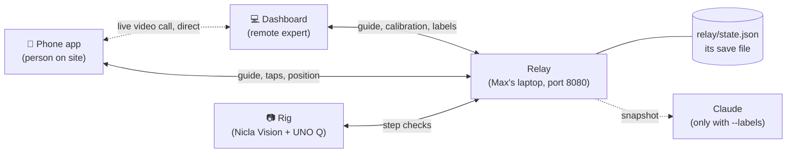
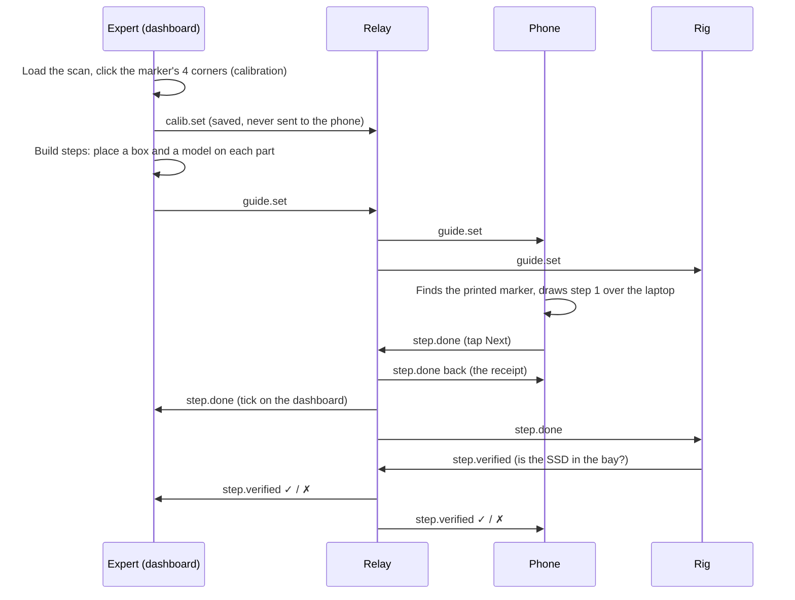

# How it works

Back to [Home](README.md).

## The four parts

- **[Dashboard](dashboard.md):** the expert's laptop screen. A 3D [scan](scans.md) of the set, and a panel to build
  a [guide](guides.md).
- **[Phone app](phone-app.md):** the person on site points an iPhone at the equipment and sees each step drawn over
  the real thing.
- **[Rig](rig.md):** a small camera that watches the open laptop and says whether a step really happened.
- **[Relay](relay.md):** the post office in the middle. Every part connects to it and it passes the
  [messages](messages.md) on. It keeps a save file, so nothing is lost if it restarts.

The live video call is the one thing that doesn't go through the relay: the phone and the dashboard send video
straight to each other once the relay has introduced them.

## One repair, start to finish

1. **Scan.** Someone scans the set (the laptop, with the printed [marker](marker-and-frame.md) taped beside it) in
   Scaniverse on a phone. The file goes in [`dashboard/public/scans/`](scans.md).
2. **Calibrate.** The expert opens the scan and clicks the marker's four corners. Now the dashboard knows where the
   marker is in the scan, so every position it sends is measured from the marker, which the phone can also see.
   [More](calibration.md).
3. **Build the guide.** For each step the expert writes an instruction and places objects on the scan: a yellow box
   round the part and a little animated model (a screw unscrewing, a hand pulling). [More](guides.md).
4. **Send.** The guide goes to the relay, which passes it to the phone and the rig.
5. **Follow.** The phone finds the same printed marker through its camera, so the boxes and models land on the real
   parts. The person does the step and taps **Next**.
6. **Check.** The rig sees whether the stickered SSD is in its bay and reports ✓ or ✗ to both screens.

## When the network drops

The phone keeps working offline. Taps are queued on the phone and sent, in order, when it reconnects. Each one is
kept until the relay sends it back as a receipt, so none is lost or counted twice. If the expert edited the guide in
the meantime, the newest guide wins and the phone keeps its place by step id. [Relay](relay.md) has the details.

> [!IMPORTANT]
> **What's real and what isn't** changes through the event. The current answer lives in
> [progress.md → Latest](https://github.com/meep-boop/durhack-2026-team-sonic/blob/main/progress.md#latest), and
> the claims we must never make are in PROJECT.md → NOW → "Never pitch". Anything simulated is labelled `SIMULATED`,
> `MOCK` or `SAMPLE` wherever it shows.
