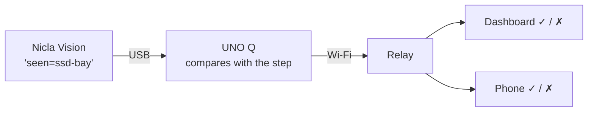

# The rig

Back to [Home](README.md) · Owner: **Ahmed** · Code and setup: [`hardware/`](https://github.com/meep-boop/durhack-2026-team-sonic/tree/main/hardware) ([README](https://github.com/meep-boop/durhack-2026-team-sonic/blob/main/hardware/README.md))

## What it does

It checks the person really did the step, so the expert doesn't have to take their word for it.

A bright sticker goes on the SSD. A small camera (the **Nicla Vision**) watches the open laptop and reports whether
the sticker is in the SSD bay. A small Linux board (the **Arduino UNO Q**) knows the current step from the
[relay](relay.md), compares what it sees with what the step expects, and sends ✓ or ✗ back. Both the
[dashboard](dashboard.md) and the [phone](phone-app.md) show it, and the UNO Q's LED matrix shows a tick or a cross.

## What a step asks it to check

A [guide](guides.md) object can carry `expect: { region: "ssd-bay", present: false }`: "after this step, the
stickered part should be gone from the SSD bay". The step that puts it back expects `present: true`.

## What it can't do

> [!CAUTION]
> It only sees whether the stickered SSD is in the bay. It can't tell whether the SSD is seated properly, and a hand
> resting over the sticker looks the same as the SSD being gone. Never pitch it as more than that.

It also needs steady light (the Nicla's camera can't lock its white balance) and must not be moved once its regions
are set, because they're in pixels. Its spot is beside the marker on the laptop's fan side.

This is our entry for the RS challenge.
