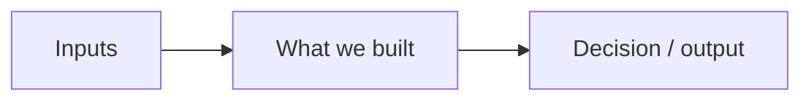

# {{PROJECT}}
> _One-line pitch._ Built by {{TEAM}} at {{EVENT}}.

**[Demo video](_link_) · [Live demo](_link_) · [Slides](_link_)**

_A screenshot or GIF of the money shot: the one frame that explains the project._

## Why
_The person, the harm, one sourced number. Two or three sentences._

## What it does
- _3–5 bullets: outputs and decisions, not features_

## How it works
_A diagram (Mermaid renders on GitHub), then a short walk through it._



## What's real
| Part | Status |
|---|---|
| _e.g. live API data_ | LIVE |
| _e.g. users_ | SIMULATED |

## Tech stack
_Each layer and why it was picked over the obvious alternative._

## Results
_Measured numbers with their baseline, and how they were measured. No unmeasured claims._

## Run it
```bash
# the exact commands, from a fresh clone
```

## Repo layout
_The top-level folders, one line each._

## Data and licences
_Every dataset and API: source, licence, how it's used._

## What went wrong, and what we changed
_Two or three honest stories: the problem, what we tried, the fix. Judges like this section._

## Limits and next steps
_What doesn't work yet and what we'd do next._

## Team
| Who | Did |
|---|---|

## Open source and acknowledgements
_Libraries, models, assets and their licences._

## AI use
_Only if the event asks for disclosure (EVENT.md §3): which tools, used for what._
